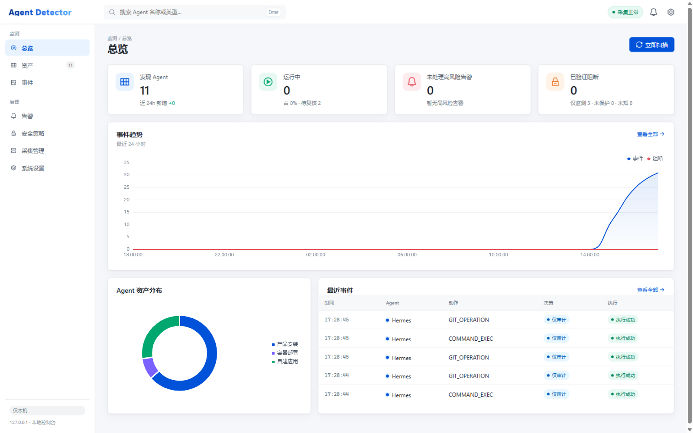
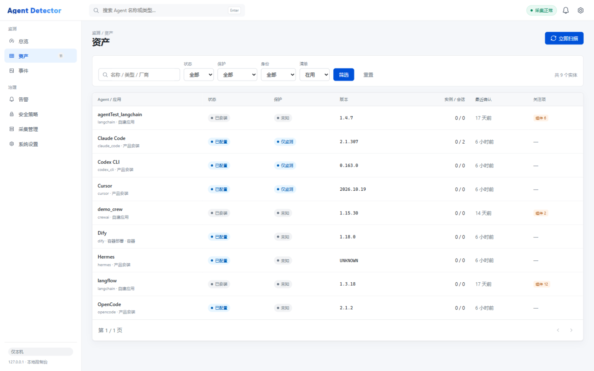
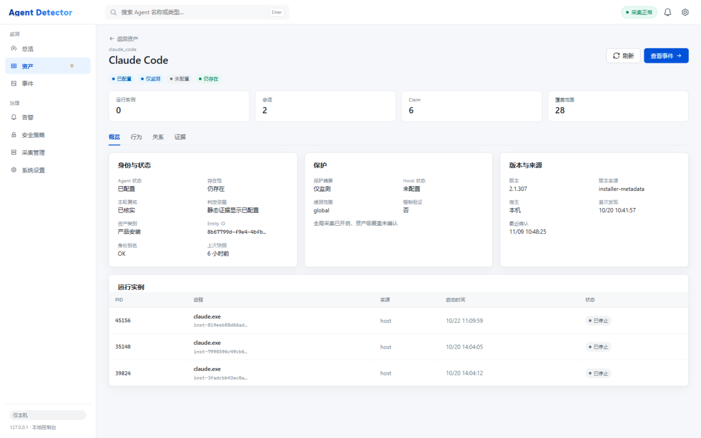
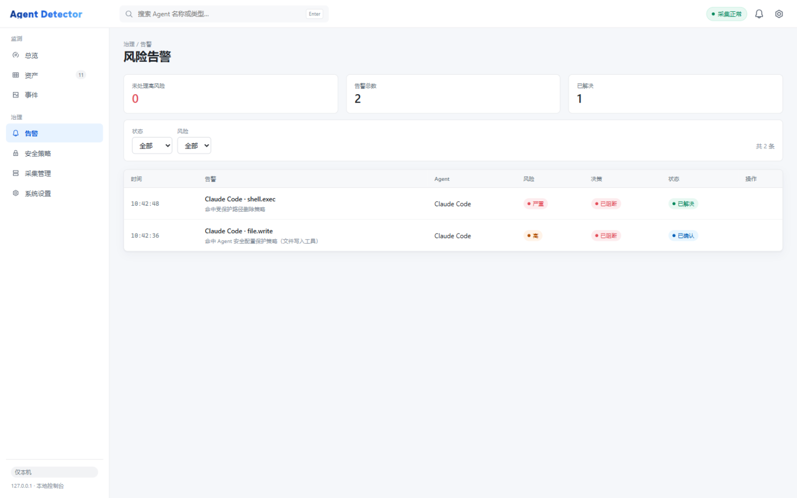
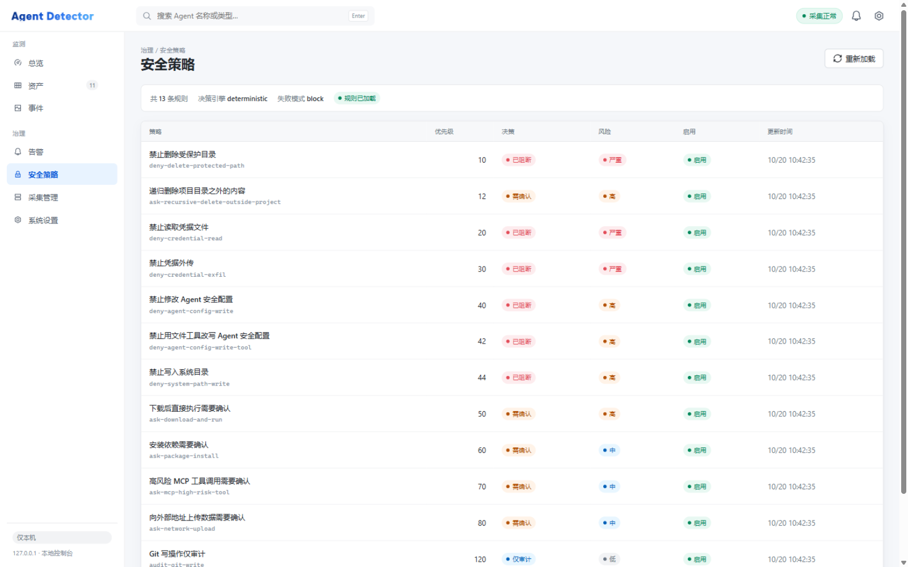
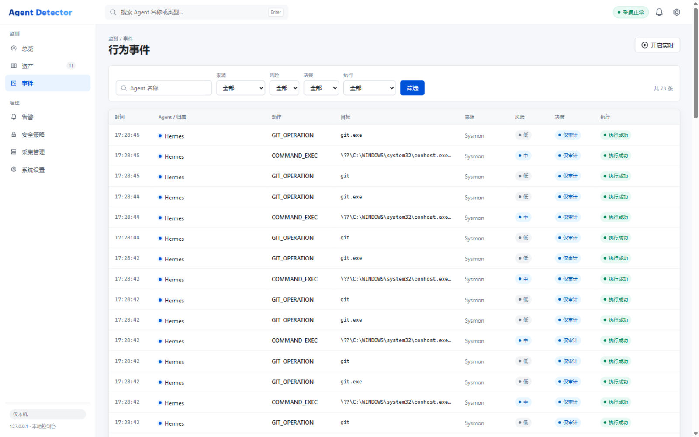
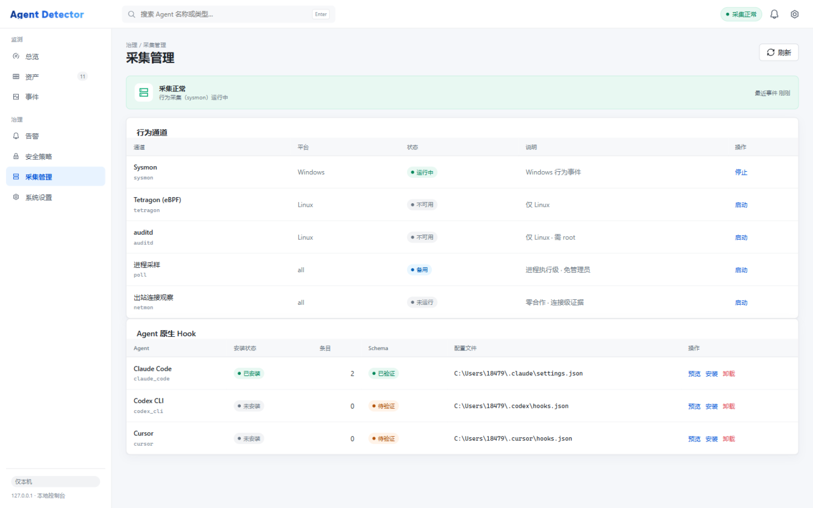

<div align="center">

# Agent Detector

**Discover, observe and pre-emptively block the AI agents running on your machine.**

**English** · [简体中文](README.zh-CN.md)

[](pyproject.toml)
[](#environment--optional-components)
[](frontend/)
[](pyproject.toml)

</div>



Agent Detector is a local security tool for AI agents. It is **not** an agent framework:
it runs *outside* the agent, watches what the agent actually does with processes, files,
network and tool calls, and can stop a tool call **before it executes** when the agent
exposes a native `PreToolUse` hook.

The modeling follows Microsoft Agent 365 / Defender: stable asset identity, evidence-backed
status, explicit coverage, and an honest distinction between *observed* and *enforced*.

> Monitoring a process that is deleting a file does not let you stop it. Only agents wired
> into a native hook can be blocked ahead of execution; everything else is labelled
> **monitor only** in the console instead of pretending to be protected.

---

## Why

Coding agents such as Claude Code, Codex CLI and Cursor run shell commands, edit files,
install packages and read credentials on the developer's own machine. They are powerful,
long-lived and largely invisible to classic endpoint inventory: an agent is not one process,
it does not have a version you can trust from the process name, and it may be a container.

Agent Detector answers four questions with evidence rather than guesses:

1. **What is installed?** — a canonical asset identity that survives restarts and PID reuse.
2. **What is running?** — instances, sessions and the tool calls they made.
3. **What did it do?** — a unified behavior timeline from hooks, OS telemetry and network observation.
4. **Can we stop it?** — deterministic `allow` / `ask` / `deny` decisions in the tool-call path.

## Three capabilities

| Mode | Data source | What you get |
| --- | --- | --- |
| **Discovery** | Processes, installer records, agent & MCP config, Docker containers | Agents with stable identity, version + `version_source`, instances and sessions |
| **Monitor** | Sysmon · auditd · Tetragon (eBPF) · process sampling · outbound connections · native hooks | Process / file / network / tool-call behavior |
| **Protect** | Native `PreToolUse` hooks (Claude Code, Codex CLI, Cursor) | `allow` / `ask` / `deny` **before** the tool call runs |

## Features

- **Canonical entity identity** — assets are keyed by a canonical `entity_id`, not by PID or
  install path. Aliases are kept permanently so historical events and alerts still resolve
  after a migration.
- **Evidence ledger** — every status claim carries the observations that produced it
  (`claims` → `claim_evidence`), so a status can be replayed and audited, not just displayed.
- **Four-axis status projection** — `presence` / `agent_status` / `verification` /
  `lifecycle` are computed separately, with an explicit `reason_code`; unseen assets keep
  their last known state and are marked *not re-verified* instead of silently disappearing.
- **Six collection channels** — hook, Sysmon, auditd, Tetragon, process poll, outbound
  connections. Each reports its own availability; a missing prerequisite degrades that
  channel only and is never disguised as healthy.
- **Deterministic policy engine** — 13 built-in rules, no LLM in the decision path. Rules
  can be disabled or have their decision overridden from the console and take effect
  immediately.
- **Fail-closed interception** — if the decision service is unreachable the tool call is
  denied by default (`AGENT_DETECTOR_HOOK_FAILURE_MODE=allow` switches to audit-only).
  `allow` is not proof of execution: the `PostToolUse` event confirms `execution_status`.
- **Container-aware discovery** — read-only Docker API (never `docker exec`) finds agents
  deployed as containers such as Dify, n8n, OpenClaw or Langflow, together with their
  components.
- **Offline replay** — audit logs and Tetragon exports can be replayed on any platform
  (`agent-detector replay`) to develop and validate detections without a target host.
- **React console** — status, protection, coverage and identity semantics are decided by the
  backend; the UI only presents them ([API contract](docs/web-console-contract.md)).

## Quick start

Windows (PowerShell):

```powershell
# 1. Install: venv + editable install + channel health check + hook token
powershell -ExecutionPolicy Bypass -File scripts\install.ps1

# 2. Start the console at http://127.0.0.1:8787
.venv\Scripts\python.exe -m agent_detector.console.cli.main serve

# 3. First scan (in another shell)
.venv\Scripts\python.exe -m agent_detector.console.cli.main scan
```

Linux / macOS (telemetry channels degrade automatically):

```bash
python3 -m venv .venv && . .venv/bin/activate
pip install -e ".[test]"
uvicorn agent_detector.console.api.app:app --host 127.0.0.1 --port 8787
agent-detector scan
```

`install.ps1` deliberately does **not**: install Sysmon, write any agent's hook config,
elevate privileges, or register a startup task.

Check what is actually available at any time:

```powershell
agent-detector channels          # or the Collectors page in the console
```

### Environment & optional components

Python dependencies are handled by `pip`. Everything below is optional — installing none of
them still starts the tool, and each absent channel is reported as unavailable/degraded.

| Component | Required | Purpose | Platform |
| --- | --- | --- | --- |
| Python ≥ 3.11 (`tomllib`) | Yes | Runtime | Any |
| Node.js ≥ 18 + npm | No* | Frontend development only (build output is committed) | Any |
| Docker Desktop / Engine | No | Container-shaped agent discovery | Any |
| Sysmon | No | Process / network / file / DNS events | Windows |
| auditd | No | Syscall-level audit rules | Linux (not in WSL2) |
| Tetragon | No | eBPF behavior collection with container identity | Linux ≥ 4.19 |
| Claude Code / Codex CLI / Cursor | No | The agents being monitored/protected | Vendor channels |

\* Frontend source lives in [`frontend/`](frontend/); rebuild with `scripts\build-web.ps1`
only when you change it.

**Sysmon** (Windows, administrator):

```powershell
winget install Microsoft.Sysinternals.Sysmon --source winget
sysmon64.exe -accepteula -i configs\sysmon.xml
```

The console usually runs unelevated and therefore cannot read the Sysmon channel. Append a
user read ACE with the **full SDDL** (query your SID with `whoami /user`):

```powershell
wevtutil sl Microsoft-Windows-Sysmon/Operational ^
  /ca:"O:BAG:SYD:(A;;0xf0007;;;SY)(A;;0x7;;;BA)(A;;0x1;;;BO)(A;;0x1;;;SO)(A;;0x1;;;S-1-5-32-573)(A;;0x1;;;YOUR-SID)"
```

If a configuration already exists, export it with `sysmon64.exe -c` and merge — do not
overwrite the whole file. Details: [docs/windows.md](docs/windows.md).

**Tetragon** (Linux, root): install v1.7.1, export to a JSON file and enable process
namespace events; the tool only tails the export, it never loads eBPF programs itself:

```bash
curl -fSL -o /tmp/tetragon.tar.gz https://github.com/cilium/tetragon/releases/download/v1.7.1/tetragon-v1.7.1-amd64.tar.gz
sudo tar -xzf /tmp/tetragon.tar.gz -C /tmp
sudo bash /tmp/tetragon-v1.7.1-amd64/install.sh
sudo mkdir -p /var/log/tetragon
sudo printf '/var/log/tetragon/events.json\n' > /etc/tetragon/tetragon.conf.d/export-filename
sudo printf 'true\n' > /etc/tetragon/tetragon.conf.d/enable-process-ns
sudo systemctl restart tetragon
```

`agent-detector tetragon` prints the current channel state and these commands at any time.
For auditd, `agent-detector audit-rules --watch-dir /path` prints the rules and install
commands; the tool never elevates privileges for you.

## Console

The console is a React 18 + TypeScript + Vite + TDesign app, built into
`src/agent_detector/console/web/next/` and served by the local API. Visual language follows
Microsoft 365 admin center / Agent 365: a white command bar, grouped left navigation,
card-based content and status badges.

<table>
<tr>
<td width="50%"></td>
<td width="50%"></td>
</tr>
<tr>
<td><sub><b>Asset inventory</b> — capability, hook state, protection state, instances/sessions.</sub></td>
<td><sub><b>Asset detail</b> — identity, protection basis, version provenance, instances, claims, coverage.</sub></td>
</tr>
<tr>
<td></td>
<td></td>
</tr>
<tr>
<td><sub><b>Risk alerts</b> — blocked tool calls with the policy that matched, acknowledge / resolve.</sub></td>
<td><sub><b>Security policies</b> — decision, risk, priority and match conditions per rule.</sub></td>
</tr>
<tr>
<td></td>
<td></td>
</tr>
<tr>
<td><sub><b>Behavior timeline</b> — unified event stream over SSE, expandable evidence tags.</sub></td>
<td><sub><b>Collectors</b> — six channel states plus per-agent hook install state.</sub></td>
</tr>
</table>

| Page | Content |
| --- | --- |
| Overview | Discovered agents, today's behavior, blocked calls, unprotected agents; trend, distribution, live events |
| Assets | Asset inventory and per-asset identity, instances, sessions, MCP servers, evidence |
| Behavior timeline | Unified event stream (hook / Sysmon / auditd / poll / network) with live SSE append |
| Security policies | 13 built-in rules; disable a rule or override its decision, effective immediately |
| Alerts | Blocked calls and high-risk events; acknowledge / resolve |
| Collectors | Six channel states, channel start/stop, hook install/uninstall (confirmed, backed up) |
| Settings | System info, hook status, auditd rule generator, support matrix, roadmap |

Anything marked *planned* in the UI is explicitly unfinished (e.g. visual policy editing,
alert notification channels); it is not disguised as implemented.

## How it works

```
             ┌──────────────────── Console (React 18 · TDesign) ────────────────────┐
             │ Overview · Assets · Timeline · Policies · Alerts · Collectors        │
             └───────────────────────────────▲──────────────────────────────────────┘
                                             │ REST + SSE · 127.0.0.1:8787
┌────────────────────────────────────────────┴─────────────────────────────────────────┐
│                                 agent-detector core                                  │
│                                                                                      │
│  Discovery  filesystem · installers · agent/MCP config · Docker API                  │
│             → canonical entities → evidence ledger → 4-axis status projection        │
│                                                                                      │
│  Monitor    Sysmon · auditd · Tetragon · process poll · netmon                       │
│             → behavior_events → policy engine → alerts                               │
│                                                                                      │
│  Protect    PreToolUse hook → POST /internal/v1/hooks/decide → allow · ask · deny     │
└──────────────────────────────────────────────────────────────────────────────────────┘
```

The interception path is intentionally small: `hook_bridge` (standard library only) sits in
the agent's tool-call path, posts to a loopback endpoint authenticated by a token, receives a
deterministic decision from the policy engine (no LLM call), records event + alert, and
translates the decision into that agent's native hook response.

```powershell
agent-detector hooks status                      # per-agent hook configuration state
agent-detector hooks plan claude_code            # dry run: print what would be written
agent-detector hooks install claude_code --apply # write (backup first, only our entries)
agent-detector hooks uninstall cursor --apply
agent-detector policy test --command "rm -rf ~/.ssh"
```

See [docs/hooks.md](docs/hooks.md) and [docs/policy.md](docs/policy.md).

## Supported agents

| Agent | Discovery | Monitor | Protect | Notes |
| --- | --- | --- | --- | --- |
| Claude Code | Yes | Yes | Yes | Native `PreToolUse` hook, token-authenticated |
| Codex CLI | Yes | Yes | Yes | Native hook adapter |
| Cursor | Yes | Yes | Yes | Native hook adapter |
| OpenCode / Hermes | Yes | Yes | Planned | Installer + config discovery, process attribution |
| Self-built (LangChain, LangGraph, CrewAI) | Yes | Yes | Planned | Identified from project dependency metadata, not process names |
| Containerized (Dify, n8n, OpenClaw, Langflow …) | Yes | Partial | Planned | Read-only Docker API; behavior limited by container visibility |

Capability levels (`P0` / `P1` / `P2` / `planned`) are shown per asset in the console, so a
partially supported agent never looks fully covered.

## CLI

```
agent-detector serve                                 Start console + decision service
agent-detector scan [--active] [--json]              Asset scan (+ agent inventory refresh)
agent-detector agents list | show <entity_id>        Agents, instances, sessions, protection
agent-detector assets [--scan-id N]                  Component assets (incl. MCP / model services)
agent-detector events [--source X] [--risk high]     Behavior events
agent-detector alerts [--status open]                Security alerts
agent-detector monitor --duration 60                 Outbound LLM call observation (zero cooperation)
agent-detector collect --mode sysmon --duration 60   System behavior collection
agent-detector replay <log> [--format tetragon]      Replay audit log / Tetragon export offline
agent-detector channels                              Collection channel health check
agent-detector audit-rules --watch-dir /path         Print auditd rules + install commands
agent-detector tetragon                              Tetragon channel state + deploy commands
agent-detector policy list | policy test --command … Policy inventory and decision self-test
agent-detector hooks status|plan|install|uninstall|snippet
agent-detector identity backfill|resolve <asset_id>  Legacy id → canonical entity
agent-detector replay-evidence --scan-id N           Re-project stored observations, no re-collection
agent-detector purge [--older-than-days N] [--all]   Retention cleanup
```

## REST API

All endpoints are served under `127.0.0.1` by default; the console contract is documented in
[docs/web-console-contract.md](docs/web-console-contract.md).

```
GET  /api/v1/overview                                    Dashboard summary
GET  /api/v1/agents | /{id} | /{id}/mcp                  Agent assets and detail
GET  /api/v1/agents/{id}/claims|coverage|relations        Evidence, coverage, relations
POST /api/v1/discovery/scan                              Start a scan
GET  /api/v1/discovery/scan/status                       Is a scan running (survives reload)
GET  /api/v1/events | /{id} | /events/stats | /events/timeseries | /events/stream
                                                         Event query (cursor), trends, SSE
GET  /api/v1/policies | PUT /{id} | POST /reload         Policy query and override
GET  /api/v1/alerts | PATCH /{id}                        Alerts
GET  /api/v1/telemetry/status | /audit-rules             Channel status, auditd rule template
POST /api/v1/telemetry/monitor/start|stop                Outbound connection observation
POST /api/v1/telemetry/behavior/start|stop               System behavior collection
GET  /api/v1/hooks | POST /{agent}/plan|install|uninstall Hook management (dry run by default)
GET  /api/v1/system | /api/v1/capabilities               Environment info, capability matrix
POST /internal/v1/hooks/decide                           Hook decision (internal, token required)
```

## Data model

- `scan_tasks` — scan generations
- `entities` / `entity_keys` / `entity_aliases` / `entity_attributes` / `entity_locations` —
  canonical asset identity and attributes
- `entity_snapshots` / `observations` / `claims` / `claim_evidence` — status projection and
  the evidence ledger
- `components` / `component_relations` — component dependency graph
- `agent_instances` / `agent_sessions` — runtime instances and hook sessions
- `behavior_events` — unified events, `source` distinguishes channels
- `security_policies` / `security_alerts` — policy overrides and alerts
- `coverage_scopes` / `coverage_scope_*` / `removal_candidates` — coverage and absence candidates

Design rules:

- Asset identity is independent of PID; instance identity includes start time (Windows reuses PIDs).
- Events store metadata and redacted summaries only — no conversation, file contents or credentials.
- Every version carries a `version_source`; without a reliable source it is reported as `UNKNOWN`.

## Configuration

| Variable | Meaning |
| --- | --- |
| `AGENT_DETECTOR_DB` | SQLite database path |
| `AGENT_DETECTOR_HOST` / `_PORT` | Bind address (default `127.0.0.1:8787`) |
| `AGENT_DETECTOR_HOOK_TOKEN` / `_HOOK_TOKEN_FILE` | Token for the internal decision endpoint |
| `AGENT_DETECTOR_HOOK_FAILURE_MODE` | `block` (fail-closed, default) or `allow` (audit only) |
| `AGENT_DETECTOR_HOOK_TIMEOUT` | Decision timeout |
| `AGENT_DETECTOR_POLICY_DIR` / `_AGENTS_FILE` | Policy and agent rules |
| `AGENT_DETECTOR_SYSMON_CHANNEL` | Sysmon event channel |
| `AGENT_DETECTOR_TETRA_LOG` | Tetragon JSON export (default `/var/log/tetragon/events.json`) |
| `AGENT_DETECTOR_AUDIT_LOG` | auditd log path |
| `AGENT_DETECTOR_RULES_DIR` / `_BEHAVIOR_RULES_DIR` | Detection and behavior rule directories |
| `AGENT_DETECTOR_ALERT_RISK_LEVEL` | Minimum risk level that raises an alert |
| `AGENT_DETECTOR_PROCESS_RESEED_SECONDS` | Full process re-calibration after dropped events |
| `AGENT_DETECTOR_PROC_SNAPSHOT` / `_PROC_SNAPSHOT_MAX_AGE` | Process registry snapshot (0600, redacted argv) |
| `AGENT_DETECTOR_COLLECTOR_STATUS` / `_COLLECTOR_STATUS_MAX_AGE` | Collector health file for cross-process counts |
| `AGENT_DETECTOR_BEHAVIOR_*` | Suppression window, rate, retention, path policy, argv storage, `IGNORE_PROC` |

Full list: [`src/agent_detector/core/config.py`](src/agent_detector/core/config.py).

## Scope & safety boundaries

- Binds to `127.0.0.1` by default; `/internal/v1/hooks/decide` is an internal endpoint
  authenticated by token — do not expose it to a network.
- Sysmon Event ID 3 (network connection) is disabled by default; enable it explicitly in
  [configs/sysmon.xml](configs/sysmon.xml).
- Sysmon file events do not cover every read/write/rename; auditd rules require root and the
  tool only prints the commands, it never elevates.
- User-level hooks are not tamper-proof (same-privilege users can edit them). Enterprise use
  needs managed configuration, ACLs and policy signing.
- Agents inside WSL2 are out of scope for now: the distro runs in a sub-PID namespace, auditd
  is unavailable, and Windows-side hooks do not apply.
- The tool never executes a discovered agent, MCP stdio startup command or skill, and never
  reads conversation or file contents.

## Project layout

```
src/agent_detector/
  aggregation/   evidence ledger, predicates, status projection, state resolver
  console/       FastAPI app, CLI, built React console (web/next)
  discovery/     filesystem, installers, frameworks, MCP, LLM config, Docker sources
  identity/      canonical entity identity and legacy aliases
  interception/  hook adapters (Claude Code, Codex, Cursor), installer, policy engine
  monitoring/    sysmon / auditd / tetragon / poll / netmon collectors, ingest, rules
  storage/       SQLAlchemy models, repository, migrations
frontend/        React 18 + TypeScript + Vite + TDesign source
configs/         Sysmon configuration and rule assets
docs/            architecture, hooks, policy, rules, per-OS and channel documentation
scripts/         install / uninstall / web build
```

## Documentation

[architecture](docs/architecture.md) · [architecture v1.2](docs/architecture-v1.2.md) ·
[Windows setup](docs/windows.md) · [hooks](docs/hooks.md) · [policy](docs/policy.md) ·
[detection rules](docs/rules.md) · [network observation](docs/behavior.md) ·
[syscall monitoring](docs/syscall-monitoring.md) · [eBPF / Tetragon](docs/ebpf-monitoring.md) ·
[Docker discovery](docs/docker-discovery.md) · [web console contract](docs/web-console-contract.md)

## Development & testing

```bash
pytest -q      # policy semantics, adapters, installer, decision endpoint, SSE,
               # collector normalization, persistence, web contract
```

Rebuild the console only when the frontend changes:

```powershell
powershell -ExecutionPolicy Bypass -File scripts\build-web.ps1
```

## Status

Pre-1.0 (`0.2.0`), Windows-first. The console and API are documented and tested but the
contract may still change between minor versions. No license file is present yet — add one
before redistributing.