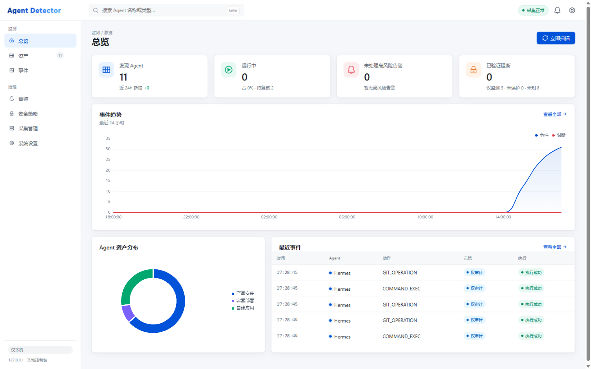
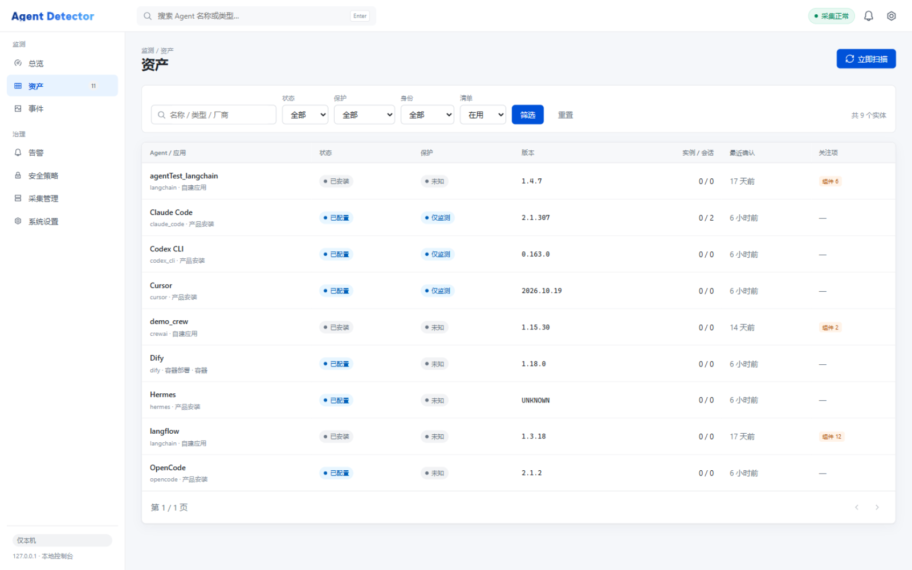
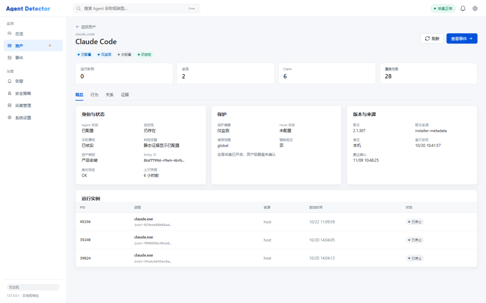
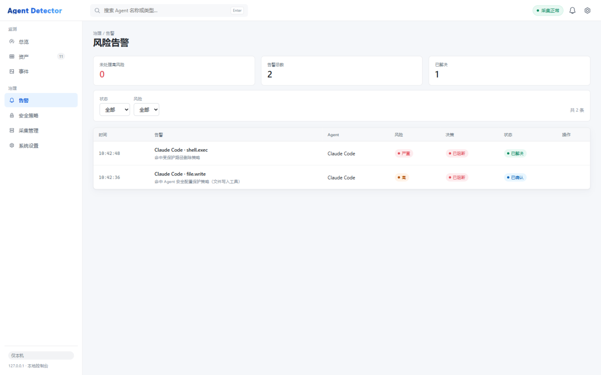
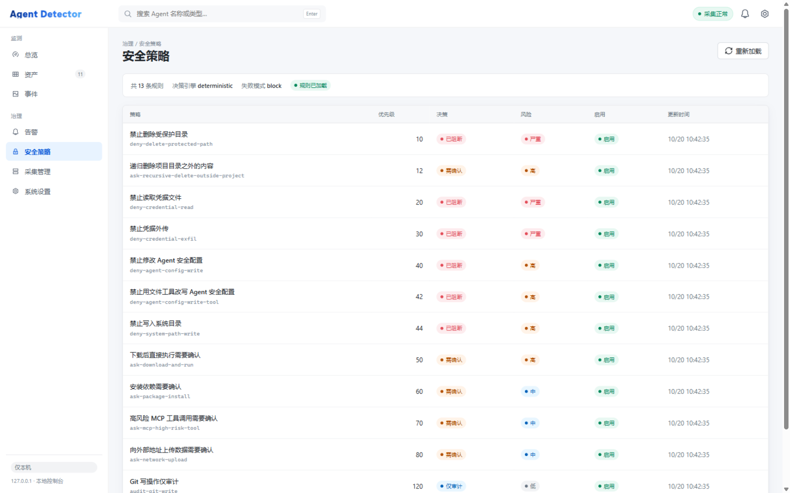
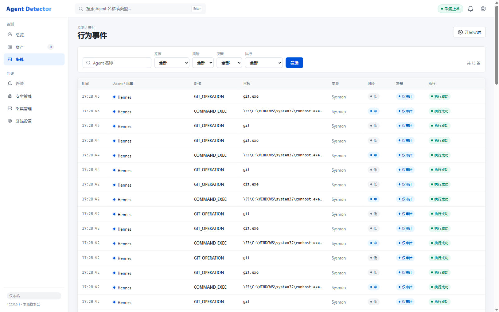
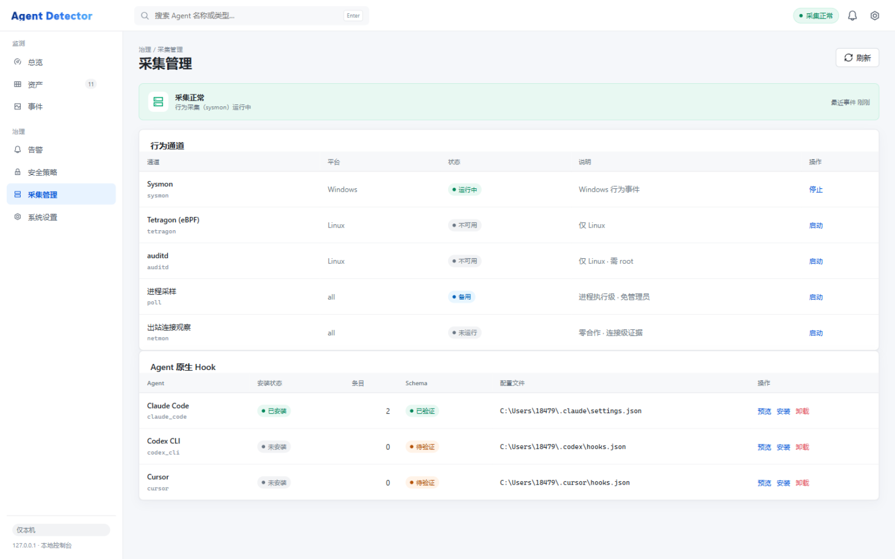

<div align="center">

# Agent Detector

**发现、观测并前置阻断本机上运行的 AI Agent。**

[English](README.md) · **简体中文**

[](pyproject.toml)
[](#环境与可选组件)
[](frontend/)
[](pyproject.toml)

</div>



Agent Detector 是本机 AI Agent 的安全检测与行为治理工具。它不是 Agent 开发框架，
而是独立运行在 Agent 外部的监测工具：观察 Agent 对进程、文件、网络与工具调用的真实行为，
并在 Agent 提供原生 `PreToolUse` Hook 时，于**工具调用执行前**做出阻断。

建模方式参考 Microsoft Agent 365 / Defender：稳定资产身份、带证据的状态、显式覆盖范围，
并且严格区分**已观测**与**已强制**。

> 监测到进程正在删除文件，不代表能在删除前阻止它。只有接入原生 Hook 的 Agent 才能被前置阻断，
> 未接入的在界面上一律显示为「仅监测」，不会伪装成已保护。

---

## 为什么需要它

Claude Code、Codex CLI、Cursor 这类编码 Agent 会在开发者本机执行命令、修改文件、安装依赖、
读取凭据。它们能力强、生命周期长，却几乎不在传统端点资产清单里：Agent 不只是一个进程，
它的版本无法从进程名推断，也可能以容器形态存在。

Agent Detector 用证据而不是猜测回答四个问题：

1. **装了什么** —— 与 PID 无关、重启后依然稳定的 canonical 资产身份。
2. **在跑什么** —— 运行实例、会话以及它们发起的工具调用。
3. **做了什么** —— 来自 Hook、系统遥测与网络观察的统一行为时间线。
4. **能不能拦** —— 在工具调用链路上给出确定性的 `allow` / `ask` / `deny` 决策。

## 三种能力

| 模式 | 数据来源 | 能做到 |
| --- | --- | --- |
| **Discovery** | 进程、安装记录、Agent 与 MCP 配置、Docker 容器 | 发现 Agent，给出稳定身份、带来源的版本、运行实例与会话 |
| **Monitor** | Sysmon · auditd · Tetragon (eBPF) · 进程采样 · 出站连接 · 原生 Hook | 进程 / 文件 / 网络 / 工具调用行为 |
| **Protect** | 原生 `PreToolUse` Hook（Claude Code、Codex CLI、Cursor） | 在工具调用**执行前** allow / ask / deny |

## 特性

- **Canonical 实体身份** —— 资产以 canonical `entity_id` 为主键，与 PID、安装路径解耦；
  `entity_aliases` 永久保留，历史事件与告警在迁移后仍可只读解析。
- **证据账本** —— 每个状态结论都带产生它的观测（`claims` → `claim_evidence`），
  状态可回放、可审计，而不只是展示。
- **四维状态投影** —— `presence` / `agent_status` / `verification` / `lifecycle` 分开裁决，
  输出明确 `reason_code`；未复核的资产保留 last known 状态并标注「未复核」，不会静默消失。
- **六条采集通道** —— Hook、Sysmon、auditd、Tetragon、进程采样、出站连接。
  每条通道各自上报可用性；缺少前置条件只降级该通道，绝不伪装成健康。
- **确定性策略引擎** —— 13 条内置规则，决策链路不调用 LLM。规则可在控制台停用或改判，
  立即生效。
- **fail-closed 前置拦截** —— 决策服务不可达时默认拒绝调用
  （`AGENT_DETECTOR_HOOK_FAILURE_MODE=allow` 可改为审计放行）。
  `allow` 不等于执行成功：由 `PostToolUse` 事件的 `execution_status` 确认。
- **容器形态发现** —— 只读 Docker API（永不 `docker exec`），可发现 Dify、n8n、OpenClaw、
  Langflow 等以容器部署的 Agent 及其组件。
- **离线回放** —— audit 日志与 Tetragon 导出可在任意平台回放
  （`agent-detector replay`），无需目标主机即可开发和验证检测规则。
- **React 控制台** —— 状态、保护、覆盖、身份语义全部由后端裁决，前端只负责呈现
  （见 [API 契约](docs/web-console-contract.md)）。

## 快速开始

Windows（PowerShell）：

```powershell
# 1. 安装：创建虚拟环境 + 可编辑安装 + 通道体检 + 生成 Hook Token
powershell -ExecutionPolicy Bypass -File scripts\install.ps1

# 2. 启动控制台 http://127.0.0.1:8787
.venv\Scripts\python.exe -m agent_detector.console.cli.main serve

# 3. 首次扫描（另开一个终端）
.venv\Scripts\python.exe -m agent_detector.console.cli.main scan
```

Linux / macOS（采集通道会自动降级）：

```bash
python3 -m venv .venv && . .venv/bin/activate
pip install -e ".[test]"
uvicorn agent_detector.console.api.app:app --host 127.0.0.1 --port 8787
agent-detector scan
```

`install.ps1` 明确**不做**的事：不安装 Sysmon、不写入任何 Agent 的 Hook 配置、不提权、
不注册开机自启。

随时体检各通道真实状态：

```powershell
agent-detector channels          # 或控制台「采集管理」页
```

### 环境与可选组件

Python 依赖由 `pip` 处理。下面全部是可选项——一个都不装也能启动，
缺失的通道会如实显示为「不可用 / 降级」。

| 组件 | 必需性 | 用途 | 平台 |
| --- | --- | --- | --- |
| Python ≥ 3.11（用到 `tomllib`） | 必需 | 运行本体 | 全平台 |
| Node.js ≥ 18 + npm | 可选* | 仅前端开发；仓库已带构建产物 | 全平台 |
| Docker Desktop / Engine | 可选 | 容器形态 Agent 发现 | 全平台 |
| Sysmon | 可选 | 进程 / 网络 / 文件 / DNS 事件 | Windows |
| auditd | 可选 | 系统调用级审计规则 | Linux（WSL2 不可用） |
| Tetragon | 可选 | 带容器身份的 eBPF 行为采集 | Linux 内核 ≥ 4.19 |
| Claude Code / Codex CLI / Cursor | 可选 | 被监测与拦截的 Agent 本体 | 各产品官方渠道 |

\* 前端源码在 [`frontend/`](frontend/)，改动后用 `scripts\build-web.ps1` 重新构建；
只用控制台则无需 Node。

**Sysmon**（Windows，需管理员）：

```powershell
winget install Microsoft.Sysinternals.Sysmon --source winget
sysmon64.exe -accepteula -i configs\sysmon.xml
```

控制台通常以普通权限运行，读不到 Sysmon 通道，需追加一条用户读权限
（必须传**完整 SDDL**，`YOUR-SID` 用 `whoami /user` 查询）：

```powershell
wevtutil sl Microsoft-Windows-Sysmon/Operational ^
  /ca:"O:BAG:SYD:(A;;0xf0007;;;SY)(A;;0x7;;;BA)(A;;0x1;;;BO)(A;;0x1;;;SO)(A;;0x1;;;S-1-5-32-573)(A;;0x1;;;YOUR-SID)"
```

已有配置时先用 `sysmon64.exe -c` 导出再合并，不要整份覆盖。详见
[docs/windows.md](docs/windows.md)。

**Tetragon**（Linux，需 root）：安装 v1.7.1，把事件导出到 JSON 文件并开启进程命名空间事件；
本工具只 tail 导出文件，不加载 eBPF 程序：

```bash
curl -fSL -o /tmp/tetragon.tar.gz https://github.com/cilium/tetragon/releases/download/v1.7.1/tetragon-v1.7.1-amd64.tar.gz
sudo tar -xzf /tmp/tetragon.tar.gz -C /tmp
sudo bash /tmp/tetragon-v1.7.1-amd64/install.sh
sudo mkdir -p /var/log/tetragon
sudo printf '/var/log/tetragon/events.json\n' > /etc/tetragon/tetragon.conf.d/export-filename
sudo printf 'true\n' > /etc/tetragon/tetragon.conf.d/enable-process-ns
sudo systemctl restart tetragon
```

`agent-detector tetragon` 可随时打印通道状态与上述命令。auditd 用
`agent-detector audit-rules --watch-dir /path` 打印规则与安装命令；工具不会自动提权。

## 控制台

控制台是 React 18 + TypeScript + Vite + TDesign 应用，构建产物位于
`src/agent_detector/console/web/next/`，由本地 API 服务提供。视觉风格参考
Microsoft 365 admin center / Agent 365：白色命令栏、分组左导航、卡片式内容区与状态徽章。

<table>
<tr>
<td width="50%"></td>
<td width="50%"></td>
</tr>
<tr>
<td><sub><b>资产清单</b> —— 能力矩阵、Hook 状态、保护状态、实例 / 会话数。</sub></td>
<td><sub><b>资产详情</b> —— 身份、保护依据、版本来源、实例、Claim 与覆盖范围。</sub></td>
</tr>
<tr>
<td></td>
<td></td>
</tr>
<tr>
<td><sub><b>风险告警</b> —— 被阻断的工具调用与命中的策略，可确认 / 解决。</sub></td>
<td><sub><b>安全策略</b> —— 每条规则的决策、风险、优先级与匹配条件。</sub></td>
</tr>
<tr>
<td></td>
<td></td>
</tr>
<tr>
<td><sub><b>行为时间线</b> —— 统一事件流，SSE 实时追加，可展开证据标签。</sub></td>
<td><sub><b>采集管理</b> —— 六条通道状态与各 Agent 的 Hook 安装状态。</sub></td>
</tr>
</table>

| 页面 | 内容 |
| --- | --- |
| 总览 | 发现 Agent、今日行为、已阻断、未启用拦截；事件趋势、资产分布、实时事件 |
| 资产 | 资产清单；详情页含身份、实例、会话、MCP、证据 |
| 行为时间线 | 统一事件流（Hook / Sysmon / auditd / 采样 / 网络），SSE 实时追加 |
| 安全策略 | 13 条内置规则；可停用规则或改判决策并立即生效 |
| 风险告警 | 阻断调用与高风险事件，可确认 / 解决 |
| 采集管理 | 六通道状态、通道启停、Hook 安装 / 卸载（确认后写入并备份） |
| 设置 | 系统信息、Hook 状态、auditd 规则生成器、支持矩阵、待开发清单 |

页面上标注「待开发」的部分是明确的未完成能力（例如策略可视化编辑、告警通知渠道），
不会伪装成已实现。

## 工作原理

```
             ┌──────────────────── Console (React 18 · TDesign) ────────────────────┐
             │ 总览 · 资产 · 时间线 · 策略 · 告警 · 采集管理 · 设置                    │
             └───────────────────────────────▲──────────────────────────────────────┘
                                             │ REST + SSE · 127.0.0.1:8787
┌────────────────────────────────────────────┴─────────────────────────────────────────┐
│                                 agent-detector core                                  │
│                                                                                      │
│  Discovery  文件系统 · 安装记录 · Agent/MCP 配置 · Docker API                          │
│             → canonical 实体 → 证据账本 → 四维状态投影                                 │
│                                                                                      │
│  Monitor    Sysmon · auditd · Tetragon · 进程采样 · netmon                            │
│             → behavior_events → 策略引擎 → 告警                                       │
│                                                                                      │
│  Protect    PreToolUse Hook → POST /internal/v1/hooks/decide → allow · ask · deny     │
└──────────────────────────────────────────────────────────────────────────────────────┘
```

拦截链路刻意做得很小：`hook_bridge`（仅标准库）位于 Agent 的工具调用路径内，通过回环地址 +
Token 调用决策接口，由策略引擎给出确定性决策（不调用 LLM），记录事件与告警，
再转换为该 Agent 的原生 Hook 响应。

```powershell
agent-detector hooks status                      # 各 Agent 的 Hook 配置状态
agent-detector hooks plan claude_code            # dry-run：打印将要写入的内容
agent-detector hooks install claude_code --apply # 写入（先备份，只增删本工具的条目）
agent-detector hooks uninstall cursor --apply
agent-detector policy test --command "rm -rf ~/.ssh"
```

详见 [docs/hooks.md](docs/hooks.md) 与 [docs/policy.md](docs/policy.md)。

## 支持的 Agent

| Agent | 发现 | 监测 | 拦截 | 说明 |
| --- | --- | --- | --- | --- |
| Claude Code | 支持 | 支持 | 支持 | 原生 `PreToolUse` Hook，Token 鉴权 |
| Codex CLI | 支持 | 支持 | 支持 | 原生 Hook 适配器 |
| Cursor | 支持 | 支持 | 支持 | 原生 Hook 适配器 |
| OpenCode / Hermes | 支持 | 支持 | 规划中 | 安装记录 + 配置发现，进程归属 |
| 自建框架（LangChain、LangGraph、CrewAI） | 支持 | 支持 | 规划中 | 由项目依赖元数据识别，不依赖进程名 |
| 容器形态（Dify、n8n、OpenClaw、Langflow…） | 支持 | 部分 | 规划中 | 只读 Docker API；行为受容器可见性限制 |

能力等级（`P0` / `P1` / `P2` / 规划中）按资产在控制台逐项展示，
部分支持的 Agent 不会看起来像被完全覆盖。

## CLI

```
agent-detector serve                                 启动控制台与决策服务
agent-detector scan [--active] [--json]              资产扫描（+ Agent 清单刷新）
agent-detector agents list | show <entity_id>        Agent 资产、实例、会话、保护状态
agent-detector assets [--scan-id N]                  组件资产（含 MCP / 模型服务）
agent-detector events [--source X] [--risk high]     行为事件
agent-detector alerts [--status open]                安全告警
agent-detector monitor --duration 60                 出站 LLM 调用观察（零合作）
agent-detector collect --mode sysmon --duration 60   系统行为采集
agent-detector replay <log> [--format tetragon]      离线回放 audit 日志或 Tetragon 导出
agent-detector channels                              采集通道可用性体检
agent-detector audit-rules --watch-dir /path         打印 auditd 规则与安装命令
agent-detector tetragon                              Tetragon 通道状态与部署命令
agent-detector policy list | policy test --command … 策略清单与决策自查
agent-detector hooks status|plan|install|uninstall|snippet
agent-detector identity backfill|resolve <asset_id>  旧 ID → canonical 实体
agent-detector replay-evidence --scan-id N           重放已存观测，不重新采集
agent-detector purge [--older-than-days N] [--all]   保留策略清理
```

## REST API

默认只监听 `127.0.0.1`；控制台契约见
[docs/web-console-contract.md](docs/web-console-contract.md)。

```
GET  /api/v1/overview                                   仪表盘汇总
GET  /api/v1/agents | /{id} | /{id}/mcp                 Agent 资产与详情
GET  /api/v1/agents/{id}/claims|coverage|relations      证据、覆盖与关系
POST /api/v1/discovery/scan                             发起扫描
GET  /api/v1/discovery/scan/status                      当前扫描是否在运行（刷新后仍可判断）
GET  /api/v1/events | /{id} | /events/stats | /events/timeseries | /events/stream
                                                        事件查询（游标）、趋势与 SSE
GET  /api/v1/policies | PUT /{id} | POST /reload        策略查询与覆盖
GET  /api/v1/alerts | PATCH /{id}                       告警
GET  /api/v1/telemetry/status | /audit-rules            通道状态与 auditd 规则模板
POST /api/v1/telemetry/monitor/start|stop               出站连接观察
POST /api/v1/telemetry/behavior/start|stop              系统行为采集
GET  /api/v1/hooks | POST /{agent}/plan|install|uninstall Hook 管理（默认 dry-run）
GET  /api/v1/system | /api/v1/capabilities              环境信息与能力清单
POST /internal/v1/hooks/decide                          Hook 决策（内部控制接口，需 Token）
```

## 数据模型

- `scan_tasks` —— 扫描代次
- `entities` / `entity_keys` / `entity_aliases` / `entity_attributes` / `entity_locations` ——
  canonical 资产身份与属性
- `entity_snapshots` / `observations` / `claims` / `claim_evidence` —— 状态投影与证据账本
- `components` / `component_relations` —— 组件依赖图
- `agent_instances` / `agent_sessions` —— 运行实例与 Hook 会话
- `behavior_events` —— 统一行为事件，`source` 区分通道
- `security_policies` / `security_alerts` —— 策略覆盖与告警
- `coverage_scopes` / `coverage_scope_*` / `removal_candidates` —— 覆盖与缺席候选

设计约束：

- 资产身份与 PID 无关；实例身份包含启动时间（Windows 会复用 PID）。
- 事件只存元数据与脱敏摘要：不含对话内容、文件内容与凭据原文。
- 版本信息一律带 `version_source`，无可靠来源输出 `UNKNOWN`。

V1.2 迁移后，旧的 `assets` / `asset_snapshots` / `evidence` / `agent_assets` /
`applications` / `application_components` 已删除，内容另存于
`data/backups/legacy-tables-*.json.gz`；`entity_aliases` 永久保留，作为历史事件 / 告警的只读 ID 桥。

## 配置

| 变量 | 含义 |
| --- | --- |
| `AGENT_DETECTOR_DB` | SQLite 数据库路径 |
| `AGENT_DETECTOR_HOST` / `_PORT` | 监听地址（默认 `127.0.0.1:8787`） |
| `AGENT_DETECTOR_HOOK_TOKEN` / `_HOOK_TOKEN_FILE` | 内部决策接口 Token |
| `AGENT_DETECTOR_HOOK_FAILURE_MODE` | `block`（fail-closed，默认）或 `allow`（审计放行） |
| `AGENT_DETECTOR_HOOK_TIMEOUT` | 决策超时 |
| `AGENT_DETECTOR_POLICY_DIR` / `_AGENTS_FILE` | 策略与 Agent 规则目录 |
| `AGENT_DETECTOR_SYSMON_CHANNEL` | Sysmon 事件通道 |
| `AGENT_DETECTOR_TETRA_LOG` | Tetragon JSON 导出文件（默认 `/var/log/tetragon/events.json`） |
| `AGENT_DETECTOR_AUDIT_LOG` | auditd 日志路径 |
| `AGENT_DETECTOR_RULES_DIR` / `_BEHAVIOR_RULES_DIR` | 检测规则与行为规则目录 |
| `AGENT_DETECTOR_ALERT_RISK_LEVEL` | 触发告警的最低风险等级 |
| `AGENT_DETECTOR_PROCESS_RESEED_SECONDS` | 事件丢失后的全量进程重校准周期 |
| `AGENT_DETECTOR_PROC_SNAPSHOT` / `_PROC_SNAPSHOT_MAX_AGE` | 进程注册表快照（0600 权限、argv 脱敏） |
| `AGENT_DETECTOR_COLLECTOR_STATUS` / `_COLLECTOR_STATUS_MAX_AGE` | 采集器健康文件，供跨进程读取真实计数 |
| `AGENT_DETECTOR_BEHAVIOR_*` | 抑制窗口、速率、保留、路径策略、是否存 argv、`IGNORE_PROC` |

完整列表见 [`src/agent_detector/core/config.py`](src/agent_detector/core/config.py)。

## 范围与安全限制

- 默认只监听 `127.0.0.1`；`/internal/v1/hooks/decide` 是内部控制接口，用 Token 鉴权，
  不要暴露到网络。
- Sysmon 的 Event ID 3（网络连接）默认关闭，需要按
  [configs/sysmon.xml](configs/sysmon.xml) 显式启用。
- Sysmon 文件事件不覆盖全部读写改名；auditd 需要 root 安装规则，工具只打印命令，不自动提权。
- 用户级 Hook 不具备不可篡改性（同权限用户可修改）；企业级需要托管配置、ACL 与策略签名。
- WSL2 内的 Agent 不在首期范围：发行版运行在子 PID namespace，auditd 不可用，
  Windows 侧 Hook 也不适用。
- 不执行被发现的 Agent、MCP stdio 启动命令或 Skill；不读取通信内容与文件内容。

## 目录结构

```
src/agent_detector/
  aggregation/   证据账本、谓词、状态投影、state resolver
  console/       FastAPI 应用、CLI、已构建的 React 控制台（web/next）
  discovery/     文件系统、安装记录、框架、MCP、LLM 配置、Docker 来源
  identity/      canonical 实体身份与 legacy 别名
  interception/  Hook 适配器（Claude Code、Codex、Cursor）、安装器、策略引擎
  monitoring/    sysmon / auditd / tetragon / poll / netmon 采集器、ingest、规则
  storage/       SQLAlchemy 模型、仓储、迁移
frontend/        React 18 + TypeScript + Vite + TDesign 源码
configs/         Sysmon 配置与规则资产
docs/            架构、Hook、策略、规则、分平台与分通道文档
scripts/         安装 / 卸载 / 前端构建
```

## 文档

[架构](docs/architecture.md) · [V1.2 架构](docs/architecture-v1.2.md) ·
[Windows 环境](docs/windows.md) · [Hook](docs/hooks.md) · [策略](docs/policy.md) ·
[检测规则](docs/rules.md) · [网络调用观察](docs/behavior.md) ·
[系统调用监测](docs/syscall-monitoring.md) · [eBPF / Tetragon](docs/ebpf-monitoring.md) ·
[容器发现](docs/docker-discovery.md) · [Web 控制台契约](docs/web-console-contract.md)

## 开发与测试

```bash
pytest -q      # 策略语义、适配器、安装器、决策接口、SSE、
               # 采集归一化、持久化、Web 契约
```

仅前端有改动时重新构建控制台：

```powershell
powershell -ExecutionPolicy Bypass -File scripts\build-web.ps1
```

## 状态

Pre-1.0（`0.2.0`），Windows 优先。控制台与 API 已有文档与测试覆盖，但契约仍可能在
minor 版本间调整。仓库暂无 LICENSE 文件，再分发前请先补充。